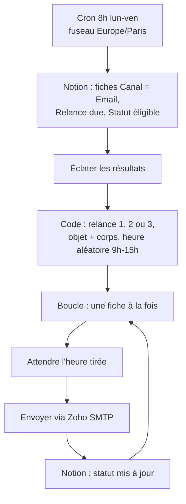

# Relances email automatiques : Notion → Zoho Mail (n8n)

> **EN:** n8n workflow that every weekday morning queries a Notion prospecting base for email follow-ups that are due, then sends each one through Zoho Mail (SMTP) at a random time between 9:00 and 15:00 and updates the record's status.
> **EN:** Follow-up subject and body are read from Notion columns; the "due" logic lives in a Notion formula, not in n8n.
> **EN:** Not tested by the author yet: use the manual dry-run described below before activating.

**FR :** Chaque matin en semaine, le workflow interroge une base Notion de prospection, repère les relances email dues, les envoie une par une via Zoho Mail à des heures aléatoires entre 9 h et 15 h, et met à jour le statut de chaque fiche.

## Problème → Solution → Pour qui

- **Problème :** les relances email J+x sont oubliées ou envoyées toutes en même temps, à une heure qui trahit l'automatisation.
- **Solution :** Notion décide quelles fiches sont dues (formule « Relance due »), n8n envoie le bon texte (relance 1, 2 ou 3) à une heure étalée et fait avancer le statut.
- **Pour qui :** indépendants et agences qui suivent leur prospection dans Notion et envoient depuis Zoho Mail. Adaptable à un autre fournisseur SMTP en changeant le credential du nœud d'envoi.

## Résultat

Aucune exécution n'est documentée. Voici ce que le nœud de préparation produit à partir d'un texte de relance stocké dans Notion (**exemple fictif**, regex du nœud exécutée localement) :

| Colonne Notion `Relance 1` (entrée) | Sujet extrait | Corps extrait |
|---|---|---|
| `Objet : Suivi de ma proposition` puis une ligne vide et `Bonjour Camille, …` | `Suivi de ma proposition` | `Bonjour Camille, …` |

Sans ligne `Objet :`, le sujet devient `Suivi — {agence}` et tout le texte sert de corps. Chaque fiche reçoit aussi une heure `sendAt` aléatoire entre 9 h et 15 h, et le workflow met à jour `Statut`, `Date dernière action` et `Template utilisé`.

<!-- TODO capture: la vue Notion avant/après une exécution de test, et le nœud Code avec la liste triée par sendAt -->

## Architecture

Statuts pris en compte : `Message envoyé` → relance 1, `Relance 1 envoyée` → relance 2, `Relance 2 envoyée` → relance 3. La base peut aussi contenir des fiches LinkedIn : seules celles avec `Canal = Email` sont traitées.

## Prérequis

- n8n auto-hébergé (un nœud Wait peut rester en attente jusqu'à environ 6 h) ; version minimale non vérifiée.
- Compte Zoho Mail avec un mot de passe d'application ; credential SMTP n8n (`smtp.zoho.com` ou `smtp.zoho.eu`, port 465, SSL/TLS).
- Credential Notion API et une base de prospection avec les propriétés ci-dessous.
- Coût : aucun appel LLM ni API payante dans ce workflow.

## Installation

1. Zoho Mail → Paramètres → Sécurité → Mots de passe d'application : en générer un (affiché une seule fois).
2. n8n → Credentials → New → SMTP : hôte `smtp.zoho.com` (ou `.eu`), port 465, SSL/TLS, utilisateur = votre adresse Zoho, mot de passe = celui de l'étape 1.
3. Importer `relance-email-zoho-v1.json`.
4. Remplacer les placeholders du tableau « Configuration » et reconnecter les credentials sur chaque nœud.
5. Laisser le workflow inactif et lancer **Execute workflow** un matin où une fiche Email est due : vérifier la sortie du nœud Code (objet, corps, `sendAt`).
6. Si la requête Notion renvoie 0 résultat ou une erreur sur la formule, adapter le filtre (voir « Statut et limites »).
7. Une fois le test concluant, activer le workflow.

## Configuration

| Placeholder | Où le trouver | Nœud concerné |
|---|---|---|
| `<YOUR_NOTION_DATABASE_ID>` | URL de la base Notion (32 caractères) | 🔍 Notion — Relances Email dues |
| `<YOUR_NOTION_CREDENTIAL_ID>` | n8n → Credentials (resélectionner) | les nœuds Notion (requête et mise à jour) |
| `<YOUR_ZOHO_SMTP_CREDENTIAL_ID>` | credential SMTP créé à l'étape 2 | 📧 Zoho — envoyer la relance |
| `<YOUR_ZOHO_EMAIL>` | votre adresse Zoho complète | champ « From » du nœud d'envoi |

### Propriétés de la base Notion (lues dans le code)

| Propriété | Type | Usage |
|---|---|---|
| `Nom`, `Agence` | Title / texte | personnalisation, sujet par défaut |
| `Mail pro` | Email | destinataire (fiche ignorée si vide) |
| `Canal` | Select | doit valoir `Email` |
| `Statut` | Select | `Message envoyé`, `Relance 1 envoyée`, `Relance 2 envoyée`, puis `Relance 3 envoyee` (sans accent, tel qu'écrit dans le code : l'option doit exister telle quelle) |
| `Relance 1`, `Relance 2`, `Relance 3` | Texte | `Objet : …` puis le corps |
| `Relance due` | Formule | décide si la fiche est due aujourd'hui |
| `Date dernière action` | Date | mise à jour à l'envoi |
| `Template utilisé` | Select | options `Relance 1` et `Relance 2` (pas de mise à jour pour la relance 3) |

## Statut et limites

- **Statut : non testé.** Le workflow est fourni comme base ; il envoie de vrais emails, d'où l'essai à blanc recommandé.
- Le filtre Notion suppose que la formule `Relance due` renvoie un texte (`"true"`). Si Notion répond *Formula property doesn't support this filter*, remplacer dans le corps de la requête `"formula":{"string":{"equals":"true"}}` par `"formula":{"checkbox":{"equals":true}}`.
- Une relance envoyée dont la mise à jour Notion échoue sera renvoyée le lendemain (aucune protection contre le double envoi autre que le statut).
- Les relances LinkedIn de la même base ne sont pas gérées.
- Prospection par email : vérifiez la réglementation applicable (consentement, désinscription).

| Symptôme | Cause probable | Action |
|---|---|---|
| 0 résultat alors qu'une relance est due | type de la formule | voir ci-dessus |
| Erreur SMTP 535 | mot de passe normal au lieu du mot de passe d'application | en régénérer un |
| Email envoyé, Notion non mis à jour | `pageId` introuvable après l'attente | vérifier que le nœud de mise à jour référence le nœud « 🧹 Préparer + planifier » |
| Envois le week-end souhaités | cron `0 8 * * 1-5` | utiliser `0 8 * * *` |

## Licence

MIT, voir [LICENSE](LICENSE).
